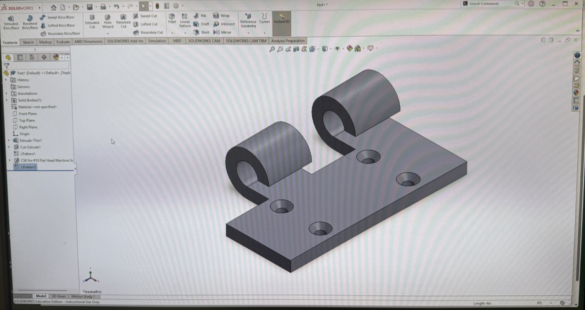

# SolidWorks Assembly Project – Part 1: Hinge

## Introduction

This project is the first component of my SolidWorks assembly project. The objective was to create a hinge that could later be inserted into a larger assembly.

Unlike my previous SolidWorks practice models, this project was designed with assembly in mind. Instead of creating one complete object in a single Part file, I created individual components that could later be combined and positioned using SolidWorks Assembly tools.

## Creating the Hinge Base

I began by creating the rectangular base plate of the hinge.

I created a 2D sketch and used dimensional constraints to define the required size and position of the geometry. I then used Extruded Boss/Base to give the plate its required thickness.

This base became the mounting surface for the rest of the hinge.

## Creating the Hinge Loops

The next step was creating the cylindrical hinge loops.

I created the required circular geometry and used additional SolidWorks features to form the curved sections of the hinge. The loops were positioned along one side of the mounting plate so that they could eventually connect with the corresponding hinge component in the assembly.

The hinge contains two separated cylindrical sections, leaving space between them for the mating hinge component.

## Creating the Mounting Holes

I also created mounting holes through the rectangular base of the hinge.

Instead of manually creating every repeated feature, I used pattern tools where appropriate to reproduce the holes and maintain consistent spacing.

These holes were later used to position the fasteners when the hinge was incorporated into the final assembly.

## Preparing the Hinge for Assembly

Once the hinge geometry was completed, I saved it as its own SolidWorks Part file.

Keeping the hinge as an independent component allowed me to insert it into an Assembly later rather than rebuilding the same geometry directly on the larger model.

It also allowed the hinge component to be reused multiple times in the completed assembly.

## What I Learned

This part gave me more experience creating a mechanical component that was specifically intended to become part of a larger assembly.

I practiced constructing repeated cylindrical geometry, creating mounting holes, and using pattern features to avoid recreating identical geometry manually.

Most importantly, I began thinking about how an individual SolidWorks Part must interact with other components rather than treating every model as an isolated object.

The completed hinge became the first reusable component of my SolidWorks assembly project.

## Completed Part

The completed hinge component is shown below.

