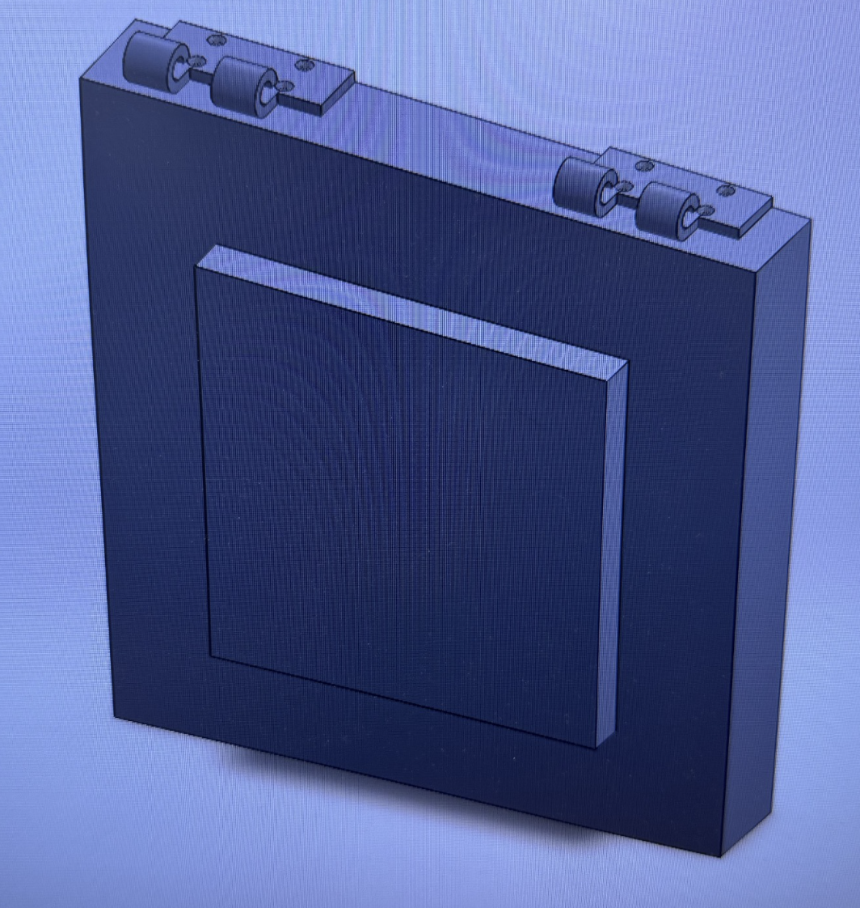

# SolidWorks Assembly Project – Part 2: Door and Hinge Assembly

## Introduction

This project is the second component of my SolidWorks assembly project. The objective was to create the main rectangular door or panel and begin using the SolidWorks Assembly environment to combine it with the hinge created in Part 1.

This was an important step because it was one of my first experiences working with separately created SolidWorks Part files inside an Assembly.

## Creating the Main Panel

I began by creating the large rectangular body that serves as the main structure of the assembly.

I created a rectangular sketch, defined its dimensions, and used Extruded Boss/Base to give the panel its required thickness.

This produced the large rectangular body that would later support the hinges and the smaller raised panel.

## Creating the Raised Panel

I created another rectangular sketch on the front face of the main body.

After positioning and dimensioning the sketch, I used Extruded Boss/Base again to create the smaller raised rectangular section visible on the front of the model.

This gave the component its two-level panel structure.

## Bringing in the Hinge

After creating the main panel, I began working with the SolidWorks Assembly tools.

Instead of recreating the hinge geometry, I used the hinge that I had already modeled as Part 1 and brought that component into the assembly.

This introduced me to one of the major advantages of assembly modeling: individual Part files can be created independently and then reused as components of a larger mechanical design.

## Positioning the Hinges

I positioned the hinge components along the upper edge of the main panel.

The completed design uses two hinge locations, one near each side of the upper edge. Because the hinge already existed as its own component, I could reuse it rather than modeling another hinge from scratch.

The hinges had to be positioned so that their mounting surfaces lined up correctly with the main panel.

## Working With an Assembly

This part of the project introduced a different SolidWorks workflow from my earlier models.

Previously, I mainly worked inside individual Part files and created all of the geometry as features of one model. With an Assembly, the components remain separate files while SolidWorks allows them to be positioned and combined into a complete design.

This required me to pay attention not only to the dimensions of the individual parts, but also to how those parts related to each other.

## What I Learned

The most important skill I practiced in this part was beginning to work with SolidWorks Assembly.

I learned that I did not need to recreate the hinge directly on the panel. Instead, I could use the hinge I had already created and insert it as a separate component.

I also gained experience positioning repeated components along a larger model and thinking about how separate parts fit together.

This project helped me understand the basic difference between Part modeling and Assembly modeling in SolidWorks and prepared the model for the additional hardware used in the final assembly.

## Completed Part

The completed panel and initial hinge assembly are shown below.

