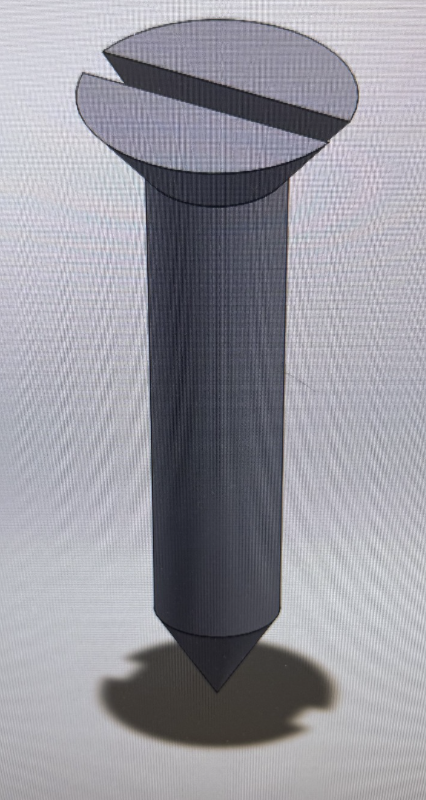

# SolidWorks Assembly Project – Part 3: Slotted Fastener

## Introduction

This project is the third component of my SolidWorks assembly project. The objective was to create a slotted fastener that could be inserted into the mounting holes of the hinge components.

Like the hinge, I created the fastener as its own SolidWorks Part file so that it could be reused multiple times in the final Assembly.

## Creating the Fastener Body

I began by creating the cylindrical body of the fastener.

I created a circular sketch and used dimensional constraints to define its diameter. I then used Extruded Boss/Base to extend the circular profile and form the main shaft.

The cylindrical shaft forms the main body of the fastener and allows it to pass through the mounting holes in the hinge.

## Creating the Pointed End

The bottom of the fastener includes a pointed end.

I created the required geometry to form the tapered point at the end of the cylindrical shaft. This gave the fastener a more detailed mechanical shape than a simple cylindrical pin.

## Creating the Fastener Head

I then created the larger circular head at the opposite end of the shaft.

The head has a greater diameter than the main body and includes a tapered transition between the head and shaft.

This created the basic shape of the fastener before adding the screwdriver slot.

## Creating the Slot

The top of the fastener required a straight slot.

I created a sketch across the top face of the fastener head and used Extruded Cut to remove the required material.

This produced the recessed slot visible across the head of the completed fastener.

## Preparing the Fastener for Assembly

After completing the fastener, I saved it as a separate SolidWorks Part file.

Because the final design required several identical fasteners, creating one reusable component was much more efficient than modeling each fastener individually.

The same Part file could be inserted into the Assembly multiple times and positioned in the different mounting holes.

## What I Learned

This part gave me additional practice creating smaller mechanical components using a combination of sketches, extrusions, cuts, and tapered geometry.

Creating the slot reinforced my experience with Extruded Cut, while the cylindrical body and enlarged head gave me more practice constructing a part from several connected features.

More importantly, this component reinforced the concept of reusable parts in an Assembly.

Instead of creating a unique model for every fastener shown in the completed design, I only needed to create the fastener once and could reuse that component throughout the final Assembly.

## Completed Part

The completed slotted fastener is shown below.

