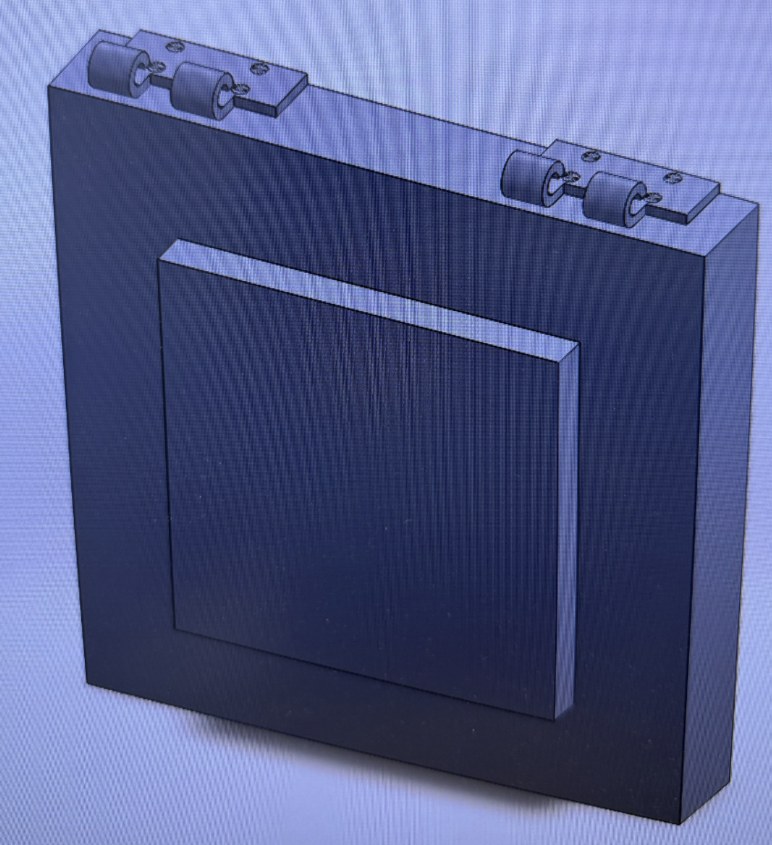

# SolidWorks Assembly Project – Part 4: Final Assembly

## Introduction

This project is the fourth and final stage of my SolidWorks assembly project. The objective was to combine the components I had previously created into one completed mechanical assembly.

The project brought together the main door or panel, the hinge components, and the slotted fasteners.

Unlike my previous individual SolidWorks models, the final result was not created as one Part file. Instead, it was constructed by combining and positioning separately modeled components inside a SolidWorks Assembly.

## Inserting the Components

I began the final assembly using the main panel as the primary structure.

I then inserted the hinge components that I had created earlier. Because the hinges existed as separate SolidWorks Part files, the same component could be reused at multiple locations.

Two hinge assemblies were positioned along the upper edge of the main panel.

## Adding the Fasteners

After positioning the hinges, I inserted the slotted fastener component into the Assembly.

Multiple instances of the same fastener were used rather than creating separate Part files for every screw.

I positioned the fasteners so that they aligned with the mounting holes in the hinge plates.

This demonstrated how a single modeled component can be reused many times within a SolidWorks Assembly.

## Positioning the Assembly Components

One of the main challenges of the final assembly was correctly positioning the separate components.

The hinges needed to sit on the upper surface of the main structure, while the fasteners needed to align with their corresponding mounting holes.

This required me to work with the relationships between separate parts rather than simply creating dimensions within one model.

The final arrangement includes two hinge locations along the top of the main structure, with the required fasteners positioned through the hinge mounting holes.

## Completed Assembly

After positioning all of the components, I completed the final SolidWorks Assembly.

The finished model combines the separately created components into one mechanical design while still preserving the individual Part files.

This means that the hinge, fastener, and other components can still be opened and modified independently while remaining part of the larger assembly.

## What I Learned

This project introduced me to one of the most important concepts in SolidWorks: creating an Assembly from multiple individual components.

My previous SolidWorks practice models primarily focused on creating individual parts using features such as Extruded Boss/Base, Extruded Cut, Mirror, Linear Pattern, Rib, Loft, and Sweep.

This project expanded that workflow by requiring me to create parts separately and then combine them into a larger mechanical system.

I learned that components do not need to be remodeled every time they appear in an assembly. The hinge and fastener components could be inserted multiple times, which made the design process more efficient.

I also gained experience positioning components and making sure separate pieces aligned correctly with one another.

Overall, this project helped me understand how individual SolidWorks Part files can work together as components of a complete Assembly and marked an important step beyond creating standalone 3D models.

## Completed Assembly

The completed SolidWorks Assembly is shown below, combining the separately created components into the final model.

