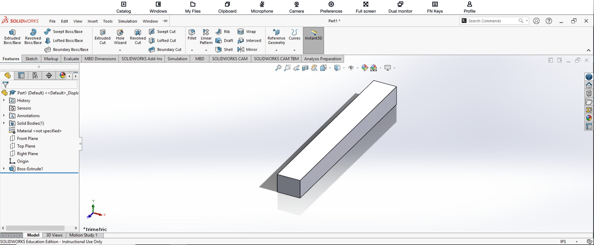

# SolidWorks Assembly 2 – Part 1

**Ryan D. Vo**  
**Cal Poly Pomona – Industrial Engineering**

## Introduction

For the first component of SolidWorks Assembly 2, I created a simple rectangular bar. Although this was the least complicated component in the project, it was important because it would later fit into the slot of the shaft and become part of the completed assembly.

## How I Created Part 1

I started a new SOLIDWORKS part and selected a standard reference plane to begin the sketch.

Using the **Rectangle** tool, I created the basic rectangular profile of the component. I then used **Smart Dimension** to control the width and height of the sketch so that the component would have the correct dimensions.

After completing the sketch, I used **Extruded Boss/Base** to extend the rectangular profile and create the long three-dimensional bar.

Because this component only required a constant rectangular cross-section, the entire part could be completed with one main extrusion.

## Features Used

- Sketch
- Rectangle
- Smart Dimension
- Extruded Boss/Base

## Completed Part

The completed rectangular bar is shown below.

## What I Learned

This component reinforced the basic process of creating a three-dimensional SOLIDWORKS part from a fully dimensioned two-dimensional sketch.

Even though the geometry was simple, I also had to keep the final assembly in mind. The dimensions of this component needed to correspond with the slot in Part 2 so that the components could properly fit together when I created the assembly.
