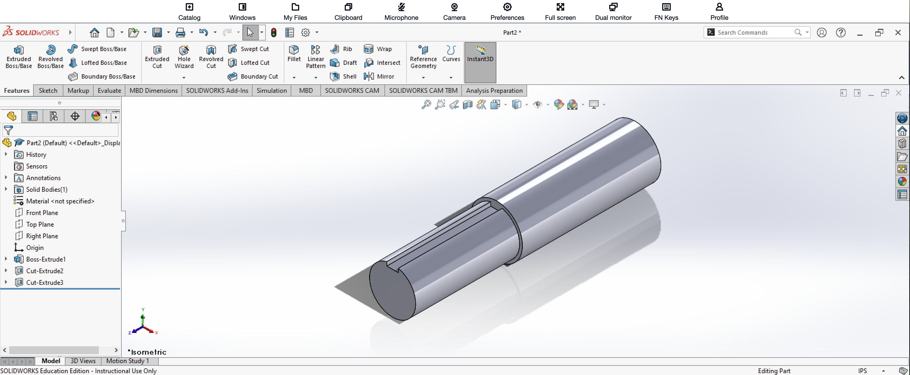

# SolidWorks Assembly 2 – Part 2

**Ryan D. Vo**  
**Cal Poly Pomona – Industrial Engineering**

## Introduction

For the second component of SolidWorks Assembly 2, I created a stepped cylindrical shaft with a longitudinal slot.

Compared with Part 1, this component required additional features because the shaft changes diameter and includes a cut that allows the rectangular component from Part 1 to fit into it.

## How I Created Part 2

I began by sketching a circle and using **Smart Dimension** to define its diameter. I then used **Extruded Boss/Base** to create the initial cylindrical shaft.

Next, I created the larger cylindrical section at one end of the shaft. This produced the stepped shape visible in the completed component.

After creating the main cylindrical geometry, I needed to make the long slot along the smaller section of the shaft.

I created a new sketch on an appropriate surface or plane and defined the slot geometry. I then used **Cut-Extrude** to remove material from the shaft.

Additional cut geometry was used where necessary to obtain the final shape of the slot and transition.

The completed result was a stepped cylindrical shaft containing a straight keyway-like slot that could interact with Part 1 in the final assembly.

## Features Used

- Sketch
- Circle
- Smart Dimension
- Extruded Boss/Base
- Cut-Extrude
- Multiple sketches and cuts

## Completed Part

The completed stepped and slotted shaft is shown below.

## What I Learned

This part gave me more practice modifying an existing solid instead of creating the entire shape from one extrusion.

I used **Cut-Extrude** to remove specific portions of the cylindrical geometry and create the slot. It also demonstrated why individual parts in an assembly have to be modeled with one another in mind. The slot in this shaft was important for allowing Part 1 to fit correctly when the components were assembled.
