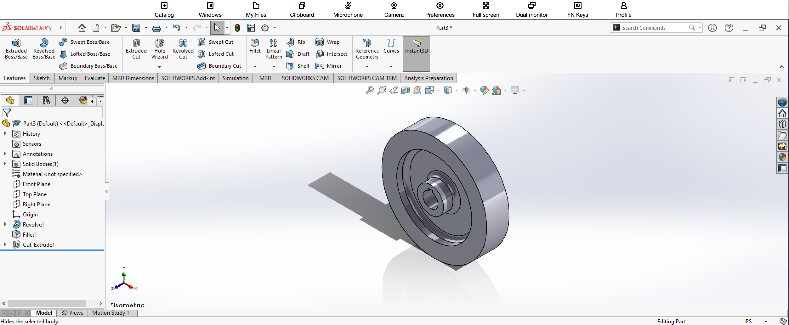

# SolidWorks Assembly 2 – Part 3

**Ryan D. Vo**  
**Cal Poly Pomona – Industrial Engineering**

## Introduction

For the third component of SolidWorks Assembly 2, I created the large circular wheel and hub.

This was the most geometrically detailed individual component in the project. Unlike the first two parts, the main shape was created using a revolved profile rather than relying primarily on Extruded Boss/Base.

## How I Created Part 3

I started by creating a two-dimensional cross-sectional sketch representing the profile of the wheel, recessed center, and hub.

Because the component is rotationally symmetric, I used **Revolved Boss/Base** to rotate the profile around a centerline. This produced the main circular wheel and its central hub geometry.

Using a revolved feature allowed several different diameters and depths to be created as part of the same rotational shape.

After creating the primary body, I used **Fillet** to round selected edges. This produced smoother transitions between some of the surfaces instead of leaving every transition as a sharp edge.

I then created the central opening using **Cut-Extrude**. This hole was necessary so that the shaft from Part 2 could be positioned through the center of the wheel during the assembly process.

## Features Used

- Sketch
- Centerline
- Smart Dimension
- Revolved Boss/Base
- Fillet
- Cut-Extrude

## Completed Part

The completed wheel and hub component is shown below.

## What I Learned

This component gave me additional experience with **Revolved Boss/Base**.

Instead of building a circular object through several separate extrusions, I could define its cross-section and revolve that profile around an axis. This was much more efficient for creating a rotationally symmetric component such as a wheel or hub.

I also practiced combining revolved geometry with **Fillet** and **Cut-Extrude** to create the final detailed component.
