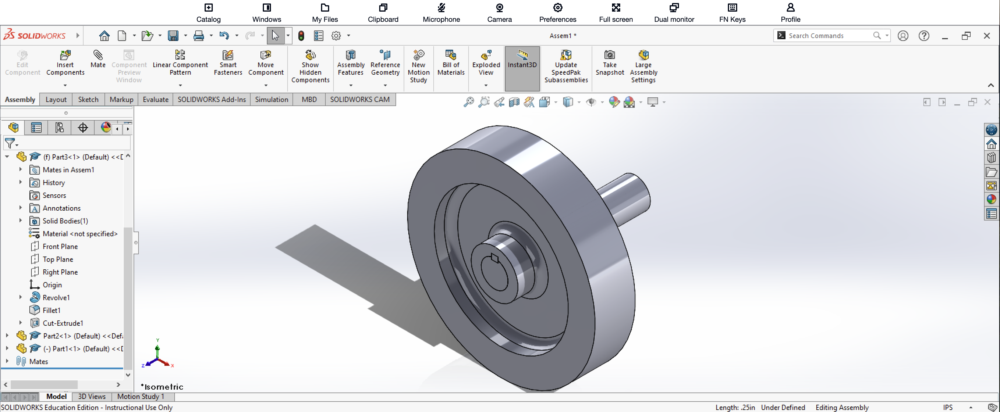

# SolidWorks Assembly 2 – Final Assembly

**Ryan D. Vo**  
**Cal Poly Pomona – Industrial Engineering**

## Introduction

After creating the three individual components, I used the **SOLIDWORKS Assembly** environment to combine them into one completed mechanical model.

The three components consisted of a rectangular bar, a stepped and slotted shaft, and a circular wheel/hub. Unlike creating a normal SOLIDWORKS part, the assembly required me to position separately modeled components relative to one another.

## Components

The final assembly uses three separately created SOLIDWORKS parts:

1. **Part 1 – Rectangular Bar**
2. **Part 2 – Stepped and Slotted Shaft**
3. **Part 3 – Wheel and Hub**

Each component was modeled individually before being inserted into the assembly.

## How I Created the Assembly

I created a new **Assembly** document in SOLIDWORKS and inserted the individual part files.

I used Part 3, the wheel and hub, as one of the main reference components for positioning the remaining parts.

Next, I inserted the cylindrical shaft from Part 2. I used **Mates** to align the cylindrical geometry of the shaft with the center opening of the wheel.

This required selecting compatible cylindrical surfaces and using the appropriate mate relationships so that the shaft and wheel shared the same center axis.

I then positioned the shaft at the correct depth relative to the wheel.

Finally, I inserted the rectangular Part 1 and aligned it with the slot in the shaft. The rectangular geometry was positioned so that it fit into the corresponding cut created in Part 2.

By combining these mate relationships, I was able to position all three independently modeled components as one mechanical assembly.

## Assembly Tools Used

- New Assembly
- Insert Components
- Move Component
- Mate
- Concentric relationships
- Coincident relationships
- Component positioning

## Completed Assembly

The completed assembly is shown below.

## What I Learned

The most important part of this project was learning that creating an assembly is different from creating a single SOLIDWORKS part.

Instead of modeling everything as one solid body, I first created **three independent part files**. I then inserted those files into an assembly and used **Mates** to define how they interacted with one another.

The cylindrical surfaces were especially useful for establishing concentric relationships between the shaft and wheel. The rectangular slot also demonstrated how geometry created in one component can be designed specifically to interact with another component.

This project helped me better understand the relationship between **part modeling and assembly modeling**. A component does not only need to look correct individually; its dimensions and geometry also need to allow it to fit correctly with the other components in the final design.
