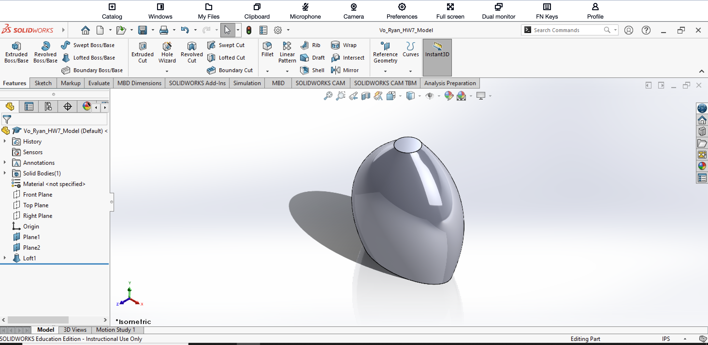

# SolidWorks Practice Model 5

## Introduction
This project is my fifth documented SolidWorks practice model. The objective was to create the shape shown in textbook exercise P4.4 using the Lofted Boss/Base feature. Unlike my previous models, which were mainly constructed from extrusions, cuts, ribs, mirrors, and patterns, this exercise focused on creating a smooth three-dimensional form by transitioning between multiple sketch profiles.

The model was defined by two ellipses and one circle placed on separate sketch planes. This exercise gave me practice creating reference planes, sketching different profile shapes, applying dimensional constraints, and combining the profiles into one continuous solid using a loft.

## Creating the First Ellipse
I began by creating the lower ellipse that defines the base of the model. According to the reference drawing, the lower profile is an ellipse with dimensions of 2.000 inches and 1.000 inch. 

I used the Ellipse sketch tool to create the profile and Smart Dimension to control its size and position. This sketch served as the first profile of the loft.

## Creating the Reference Planes
Because the loft required three profiles at different heights, I needed additional sketching surfaces above the original profile. 

I created two reference planes using the Reference Geometry tools. The middle ellipse was positioned 3.000 inches above the lower ellipse, while the upper circular profile was positioned another 2.000 inches above the middle profile.

Creating these planes allowed each profile to be sketched at the correct height while remaining aligned for the loft operation.

## Creating the Second Ellipse
On the first reference plane, I created the second ellipse.

The reference drawing specifies dimensions of 2.200 inches and 1.500 inches for this middle profile. I used Smart Dimension to define the ellipse according to these measurements.

This profile is slightly larger than the lower ellipse, which helps create the wider middle portion of the finished model.

## Creating the Top Circle
On the second reference plane, I created the final profile of the model. 

Unlike the first two profiles, the top profile is a circle with a diameter of 1.000 inch. I positioned and dimensioned the circle according to the textbook drawing.

The smaller circular profile creates the rounded taper toward the top of the finished shape.

## Creating the Loft
After completing the two ellipses and the circle, I used Lofted Boss/Base to connect the three profiles.

I selected the lower ellipse, middle ellipse, and upper circle in sequence so that SolidWorks could generate a smooth transition between them. The resulting Loft feature formed the entire solid body as one continuous shape.

The completed model gradually expands from the lower ellipse into the larger middle ellipse and then narrows toward the circular profile at the top.

## Completed 3D Model
The completed model is shown below in an isometric view. The SolidWorks FeatureManager tree also shows the two reference planes and the Loft feature used to construct the model.

 
## What I Learned
This exercise introduced me to a different method of creating three-dimensional geometry in SolidWorks.

Instead of building the part primarily from extruded sketches, I learned how Lofted Boss/Base can create a smooth solid by transitioning between profiles with different shapes and sizes.

I also gained more experience creating reference planes. Since the three profiles had to be located at different heights, the additional planes were necessary for positioning the middle ellipse and top circle correctly.

Smart Dimension was important for defining the two ellipses and the circular profile according to the dimensions in the reference drawing. I also learned that the order and alignment of the loft profiles are important because they determine how SolidWorks transitions between the different sketches.

Compared to my previous SolidWorks practice models, this exercise expanded my understanding of how more organic and curved shapes can be created using reference geometry and lofted features.

## Reference
This model was based on textbook exercise P4.4, which required the shape to be created as a loft defined by two ellipses and one circle. All dimensions in the exercise are in inches.
