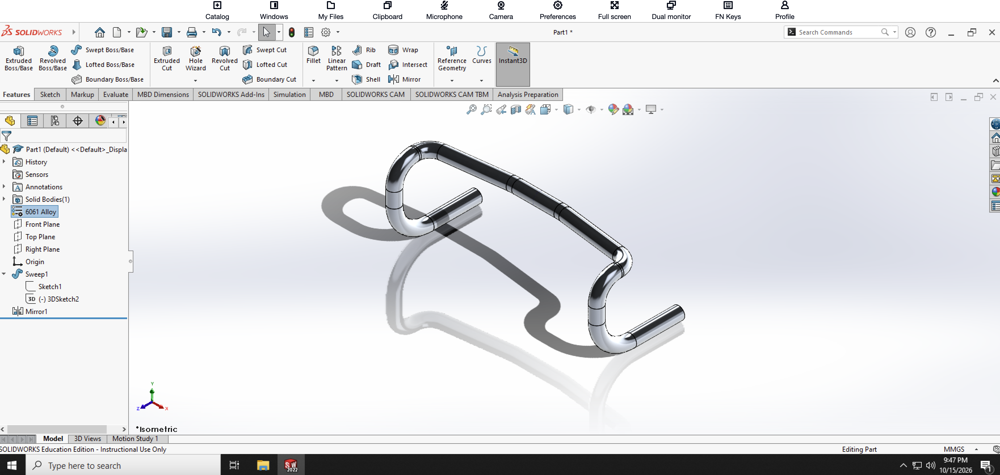

# SolidWorks Practice Model 6

## Introduction

This project is my sixth documented SolidWorks practice model. The objective was to create a bent tubular frame using the Swept Boss/Base feature and a combination of 2D and 3D sketch geometry.

Compared to my previous SolidWorks practice models, this exercise introduced more practice with 3D Sketch and Sweep. Instead of creating the main shape from a conventional extrusion or loft, I created a profile and guided it along a multi-directional path to form the tubular structure.

I also used the Mirror feature to reproduce symmetrical geometry and assigned 6061 Alloy as the material for the completed model.

## Creating the Sweep Profile

I began by creating the profile that would define the cross-section of the tubular frame.

This profile was used with Swept Boss/Base, which requires both a profile and a path. Rather than extruding the profile in a single straight direction, the sweep allowed the same cross-section to follow the bends and changes in direction of the frame.

## Creating the 3D Sketch Path

One of the main skills I practiced in this model was creating a 3D Sketch.

Unlike a standard 2D sketch, the 3D sketch allowed the sweep path to extend in multiple directions and planes. I constructed the path to define the straight sections and bends of the frame.

Creating the path correctly was important because the final shape of the Swept Boss/Base depended directly on the geometry of the 3D sketch.

The combination of straight segments and curved transitions produced the continuous bent shape visible in the finished model.

## Creating the Sweep

After completing the profile and 3D sketch path, I used Swept Boss/Base to create the main solid.

I selected the sketch profile as the sweep profile and the 3D sketch as the path. SolidWorks then carried the profile along the entire path, producing a continuous tubular body with smooth bends.

This was different from using Extruded Boss/Base because the geometry was able to follow a complex path rather than extending only in one direction.

## Mirroring the Geometry

The model contains symmetrical portions, so I used the Mirror feature rather than manually rebuilding matching geometry.

After completing the required geometry on one side, I selected the appropriate plane and used Mirror to reproduce it on the opposite side.

Using Mirror helped maintain symmetry and reduced the amount of repeated modeling required.

## Assigning the Material

After completing the geometry, I assigned **6061 Alloy** as the material for the part.

Assigning a material gives the SolidWorks model material properties in addition to its geometric shape. The selected material is also displayed in the FeatureManager design tree.

## Completed 3D Model

The completed model is shown below in an isometric view. The SolidWorks FeatureManager tree also shows the Sweep feature, its associated sketches, the 3D Sketch path, the Mirror feature, and the assigned 6061 Alloy material.

## What I Learned

This exercise gave me more experience creating geometry that cannot easily be produced with basic extrusions.

The most important skill I practiced was using Swept Boss/Base. I learned that a sweep uses a profile together with a path, allowing a constant cross-section to travel through a more complex shape.

I also gained experience using 3D Sketch. This allowed me to create a path that changed direction in three-dimensional space instead of being restricted to a single sketch plane.

Using Mirror reinforced the importance of taking advantage of symmetry rather than manually creating identical geometry. This made the modeling process more efficient and helped keep both sides consistent.

Finally, I practiced assigning a specific engineering material by applying 6061 Alloy to the finished part.

Compared to my previous SolidWorks practice models, this project expanded my understanding of 3D sketching and path-based features and showed how Sweep can be used to create continuous bent structures and tubular geometry.
