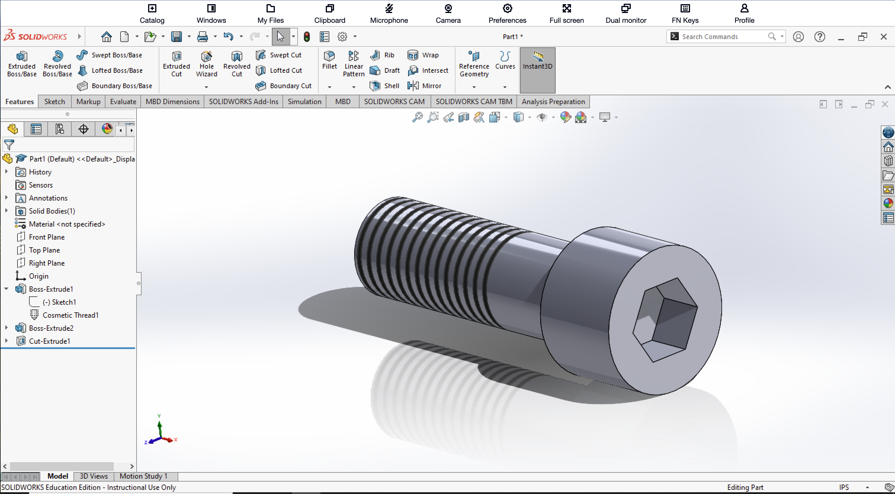

# SolidWorks Practice Model 7

## Introduction

This project is my seventh documented SolidWorks practice model. The objective was to create a socket-head threaded fastener using several SolidWorks features, including Extruded Boss/Base, Cosmetic Thread, and Extruded Cut.

Compared to my previous SolidWorks practice models, this exercise gave me more experience creating cylindrical mechanical components and representing threaded geometry. I also practiced constructing a recessed hexagonal socket in the head of the fastener.

## Creating the Main Shaft

I began by creating a circular sketch for the main cylindrical shaft of the fastener.

I used Smart Dimension to define the diameter of the circle and then used Extruded Boss/Base to extend the sketch to the required length.

This created the basic cylindrical body that would later contain the threaded section.

## Creating the Threaded Section

After creating the main shaft, I added the threaded portion of the fastener.

For this model, I used the Cosmetic Thread feature to represent the external threads. Cosmetic Thread allowed me to show the threaded region without having to physically model every individual helical thread.

The threaded section extends along a large portion of the shaft while leaving an unthreaded section near the head of the fastener.

Using Cosmetic Thread provided a simpler and more efficient way to represent standard threaded geometry.

## Creating the Fastener Head

Next, I created the larger cylindrical head of the fastener.

I created another circular sketch at the end of the shaft and used Extruded Boss/Base to form the head. The larger diameter distinguishes the head from the main shaft and creates the basic shape of a socket-head fastener.

This resulted in a second Boss-Extrude feature in the SolidWorks FeatureManager tree.

## Creating the Hexagonal Socket

The front face of the fastener head required a recessed hexagonal socket.

I created a new sketch on the circular front face of the head and used the Polygon sketch tool to create a six-sided hexagon.

I positioned the hexagon at the center of the circular face and used dimensional constraints to control its size.

After completing the sketch, I used Extruded Cut to remove material from the head and create the recessed hexagonal socket.

This produced the final socket feature visible on the front of the completed model.

## Completed 3D Model

The completed model is shown below in an isometric view. The SolidWorks FeatureManager tree also displays the main features used during construction, including Boss-Extrude, Cosmetic Thread, a second Boss-Extrude, and Cut-Extrude.

## What I Learned

This exercise gave me more experience creating cylindrical mechanical components using feature-based modeling techniques.

One of the most important skills I practiced was using Cosmetic Thread to represent external threads. Instead of creating detailed helical thread geometry, Cosmetic Thread provided a simpler representation of the threaded portion of the fastener.

I also gained additional experience building a model from multiple Boss-Extrude features. The first extrusion created the main shaft, while another extrusion created the larger cylindrical head.

Creating the recessed socket also gave me more practice using the Polygon sketch tool and Extruded Cut. By sketching a centered hexagon on the front face of the head and cutting it into the model, I was able to create the internal socket.

Compared to my previous SolidWorks practice models, this project helped me better understand how relatively simple sketches and features can be combined to create a recognizable mechanical fastener.

Overall, this model gave me additional practice with Extruded Boss/Base, Cosmetic Thread, polygon sketches, dimensional constraints, and Extruded Cut.
